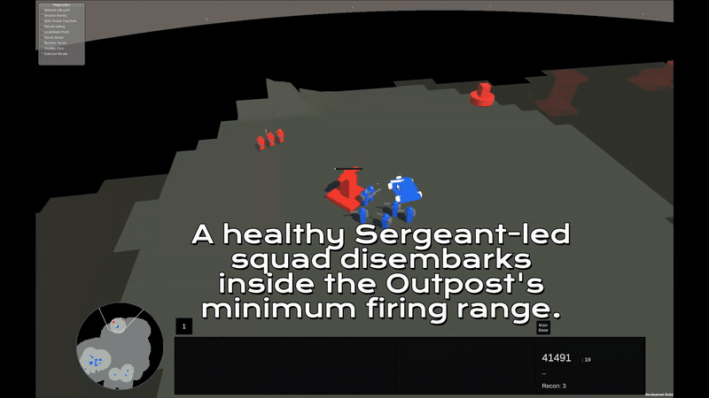

# TRIHOLD

### An independent science-fiction real-time strategy game in development

**Territory is an investment. Information is an advantage. An army is more than its numbers.**

*Game design · Decision-driven scenarios · Developer's journal · An invitation to collaborate*

> **Naming note:** **Trihold is a development codename, not the final game title.** The project's identity and branding are still evolving.

---

## A strategy game about decisions that connect

I am developing a stylized, low-poly, sci-fi RTS with a browser-oriented multiplayer ambition. It is designed around a simple idea: **what you build, what you know, where you move, and what you manage to preserve should influence one another.**

Imagine starting a match with nearby Mine sites. You can invest in reliable income, send infantry into Recon mode to find valuable field rewards, or attempt both. An Outpost opens new construction territory but becomes a position you must defend. A Scout Car can hunt exposed Recon soldiers or deliver a squad into an Outpost raid—but losing it might turn a captured strongpoint into an impossible position to hold.

The project's design is not about finding one impressive unit and using it everywhere. It is about the choices around timing, investment, information, tactical control and consequences.

**This is a development journal—not a released game, a download page, or a public copy of the private source-code repository.**

## Gameplay in Action — Work-in-Progress Footage

[Watch the full video (MP4)](media/videos/05-scout-car-outpost-raid.mp4) · **Work in progress — actual Unity prototype gameplay**

Scout Car transport delivers an infantry-led capture that changes territorial control and the associated Mine economy. This is actual Unity prototype gameplay, with unfinished art and animation, rather than a trailer for a finished game.

[**Explore all five gameplay recordings →**](media/README.md)

## The decisions at the heart of a match

| Your choice | What makes it interesting |
| --- | --- |
| **Mines or Recon?** | Dependable income and territorial investment versus variable field rewards, exploration and exposure. |
| **Expand or mobilize?** | A new Outpost can unlock better Mine sites, but an early Scout Car can protect territory or pressure the opponent. |
| **Scout or protect?** | The same mobile unit cannot patrol for vulnerable enemy Recon and guard every Outpost at once. |
| **Capture, hold or retreat?** | A Scout Car can deliver the squad that takes an Outpost; keeping the vehicle and holding the gain are separate problems. |
| **Fight or preserve?** | Fatigue, Sergeant leadership, injuries and casualty evacuation affect the real cost of an engagement. |

[**Read the playable-design scenarios →**](scenarios/README.md)

## What exists today?

Development work already covers the foundations of a multiplayer RTS: Main Menu, host/join lobby and ready flow, camera and selection controls, Credits and Mines, Outposts and construction reach, Recon resource collection, infantry squads, Scout Car combat and transport, stamina, injuries, Infirmary treatment, fog of war, minimap/radar information, and developing Sergeant traits and morale.

These are **not all finished, polished or fully validated**. There are documented manual tests and meaningful functioning systems, alongside networking, presentation, balance and integration work still to do. In particular, Base 2 content, Command Point spending, broad vehicle repair and heavy siege capabilities are **future design directions**.

[**A precise progress snapshot →**](progress/what-exists-today.md)

## The battlefield will evolve

At **Base 1**, Scout Cars have an unusually important military role. Infantry are poorly suited to destroying a car, while Outposts provide powerful defense and are more realistically **captured** than demolished with early forces. When both players field Scout Cars, the contest remains about Recon, expansion, positioning, investment and macro/micro execution.

At **later technology levels**, specialist units, vehicles, stronger anti-armor options and tools for breaking fortified positions are intended to alter those relationships. A heavy tank is envisioned as a late-game threat to structures—but not an existing playable unit or a guaranteed final-balance outcome.

[Future direction →](progress/future-direction.md)

---

## Explore the project

| Interested in… | Start here |
| --- | --- |
| **The game itself** | [Overview](game/overview.md) · [Gameplay systems](game/gameplay.md) |
| **Interesting RTS scenarios** | [Scenario collection](scenarios/README.md) |
| **Design thinking** | [Design philosophy](game/design-philosophy.md) · [Manifesto](MANIFESTO.md) |
| **Genuine progress** | [What exists today](progress/what-exists-today.md) · [Future direction](progress/future-direction.md) |
| **The person making it** | [About the developer](about/developer.md) · [The journey](development/journey.md) |
| **AI and development practice** | [AI-assisted development](development/ai-assisted-development.md) |
| **Art and collaboration** | [Visual direction](visual-direction/art-and-animation.md) · [Work with me](collaboration/work-with-me.md) |

### Five scenarios worth starting with

1. [**The First Five Minutes — Mines or Recon?**](scenarios/01-first-five-minutes.md)
2. [**The Scout Car Timing Window**](scenarios/02-scout-car-timing.md)
3. [**Capture, Hold, or Retreat?**](scenarios/03-capture-hold-retreat.md)
4. [**When Six Soldiers Lose to Three**](scenarios/04-six-versus-three.md)
5. [**Saving the Wounded**](scenarios/05-saving-the-wounded.md)

## Behind the project

I am **Ömer Zahid Kara**, a computer science graduate and lifelong player of strategy and other games. After software-development experience, internships and an earlier mobile-game experiment, I decided to attempt a long-held RTS ambition. More capable AI-assisted tools made an ambitious prototype feel technically approachable as an independent developer; they did not remove the responsibility to test, critique and eventually make it fun.

Visual production is a major unfinished area. I would particularly like to hear from artists and collaborators interested in **stylized low-poly 3D, animation, VFX and readable science-fiction RTS art**.

**Contact:** [Email](mailto:omerzahidkara1@gmail.com) · [LinkedIn](https://www.linkedin.com/in/%C3%B6mer-zahid-kara-b642862a4/) · [Collaboration details](collaboration/work-with-me.md)

---

Public journal draft: October 2026. No game release date, public demo or finished art is being announced. Trihold is a working codename. No license is granted by default for text or future assets in this repository.
