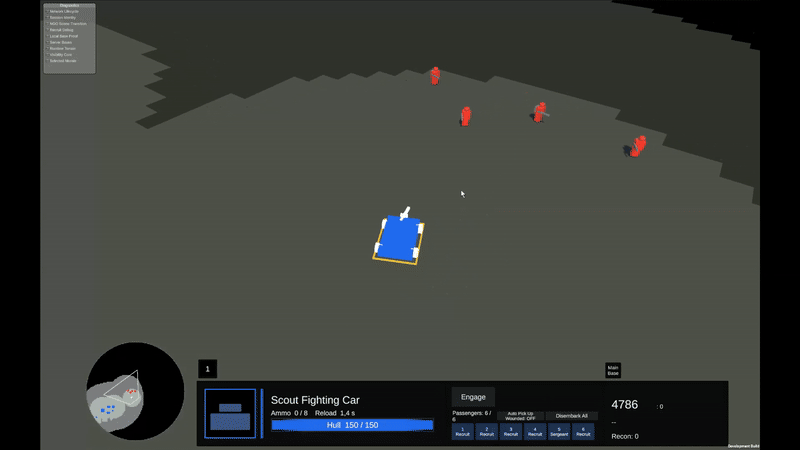
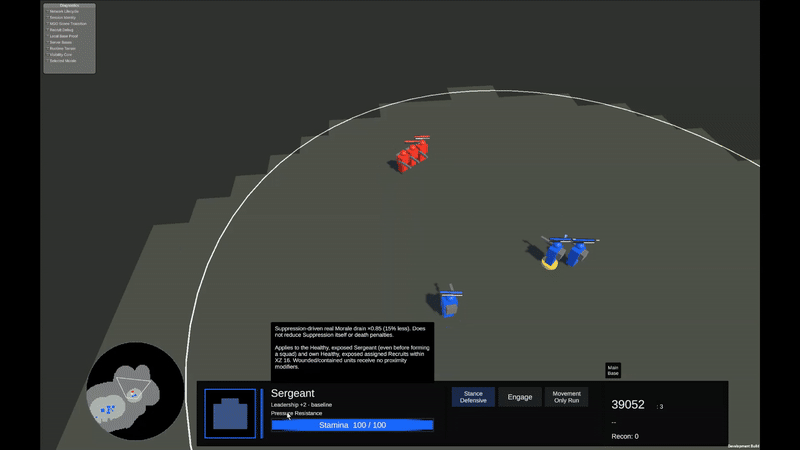

# Gameplay Gallery

These are authentic, edited Unity gameplay recordings from the current prototype. Some footage has been accelerated or trimmed; art, animation and VFX remain unfinished. These development demonstrations are not presented as independent multiplayer matches, a public demo or commercial trailer footage. **Trihold remains a temporary development codename.**

## Building the Economy

[Watch the full video (MP4)](videos/01-mine-construction.mp4) · **Work in progress — actual Unity prototype gameplay**

Two infantry approach a Mine site, satisfy its worker requirement and construct the Mine. The final sequence shows a blocked attempt to place an Outpost immediately beside this Mine in this situation; it does not establish a universal ban on Outposts near Mines.

[Explore the strategic question →](../scenarios/01-first-five-minutes.md)

## Hunting Enemy Recon

[Watch the full video (MP4)](videos/02-scout-hunts-recon.mp4) · **Work in progress — actual Unity prototype gameplay**

A Scout Car hunts and eliminates exposed enemy infantry in Recon mode. The recording shows the risk of sending Recon into the open during the early Scout Car window, without establishing that Recon is economically useless or that every encounter ends this way.

[Explore the strategic question →](../scenarios/02-scout-car-timing.md)

## Rescuing the Wounded

[Watch the full video (MP4)](videos/03-wounded-recovery.mp4) · **Work in progress — actual Unity prototype gameplay**

An infantry engagement leaves a friendly soldier wounded; an arriving Scout Car automatically collects the eligible casualty. Transport to an Infirmary, treatment and recovery to a healthy state complete the rescue chain, illustrating what force preservation can save and what it asks of a transport.

[Explore the strategic question →](../scenarios/05-saving-the-wounded.md)

## Leadership Against the Odds

[Watch the full video (MP4)](videos/04-sergeant-defensive-stand.mp4) · **Work in progress — actual Unity prototype gameplay**

In this recording, three blue defenders led by a trait-bearing Sergeant defeat six red attackers. Leadership, defensive stance, fatigue and combat mechanics interact here; this observed victory does not isolate one decisive modifier or guarantee a repeatable outcome.

[Explore the strategic question →](../scenarios/04-six-versus-three.md)

## Capturing Enemy Territory

[Watch the full video (MP4)](videos/05-scout-car-outpost-raid.mp4) · **Work in progress — actual Unity prototype gameplay**

Infantry board a Scout Car, approach an enemy Outpost, disembark near its close-range defensive blind spot and capture it with an eligible squad. In this recorded scenario, the associated Mine stops paying the red player for 60 seconds before transferring to blue, connecting the raid to territorial and income consequences.

[Explore the strategic question →](../scenarios/03-capture-hold-retreat.md)

[Scenario collection](../scenarios/README.md) · [Visual direction](../visual-direction/art-and-animation.md) · [Journal home](../README.md)
