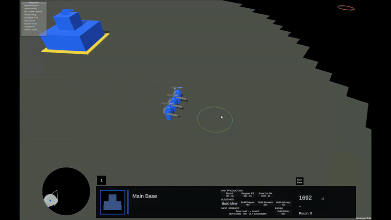

# 01 — The First Five Minutes: Mines or Recon?

**Focus:** economy, early production and contested map information.

## Recorded Prototype Gameplay

[Watch the full video (MP4)](../media/videos/01-mine-construction.mp4) · **Work in progress — actual Unity prototype gameplay**

Two infantry approach a Mine site, satisfy its worker requirement and construct the Mine. The final sequence shows a blocked attempt to place an Outpost immediately beside this Mine in this situation; it does not establish a universal ban on Outposts near Mines.

## The situation

The home Base has two nearby Level 2 Mine sites. Mines require two eligible infantry workers to construct. A player can form a Sergeant-led squad, build the opening Mines, place an Outpost farther forward and reach another Mine site. A standard opening of this general kind is estimated by the developer at roughly five minutes; it is not a recorded speed benchmark.

Alternatively, the player can make more infantry and send them into Recon mode. Recon soldiers search the map for fragments that award Credits and Command Points. Their movement can avoid acid terrain; hostile infantry, Outposts and Scout Cars remain dangerous.

## The decision

| Mine-led opening | Recon-heavy opening |
| --- | --- |
| Predictable income once built | Potentially high but variable rewards |
| Extends useful territory through Outposts | Explores territory and reveals threats |
| Uses soldiers for construction and defense | Spends more on exposed infantry |
| Easier to plan around | More dependent on survival, opportunity and attention |

A hybrid opening competes with both extremes.

## Counterplay

An early enemy Scout Car can punish Recon infantry in the open. A player who mobilizes too soon may be behind on infrastructure. A Mine-focused player who never builds mobile defense may find the whole frontier vulnerable.

## What is real, and what is not proven?

**Implemented:** Mine construction and income, Outposts, Recon movement and resource collection.

**Hypothesis:** A sizeable early group of roughly eight to ten Recon soldiers could produce greater returns than fixed Mines under some conditions. This has not been established by representative multiplayer balance tests.

**Test question:** After factoring in losses, opportunity costs and variable fragment supply, which openings remain viable?

[Next →](02-scout-car-timing.md)
