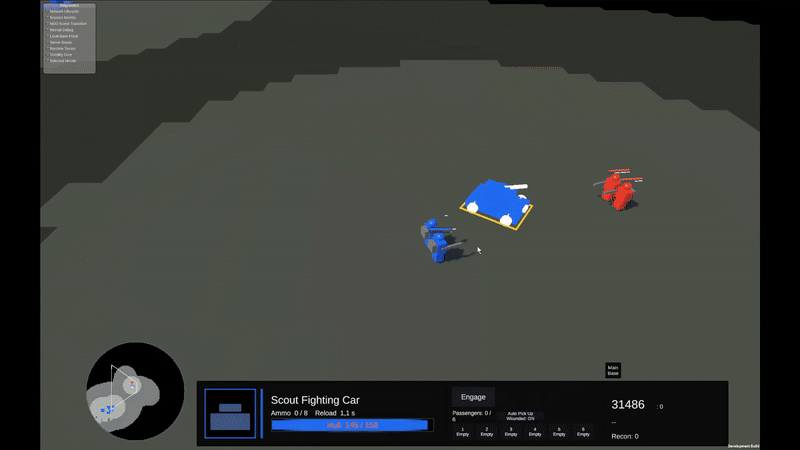

# 05 — Saving the Wounded

**Focus:** casualties, transport risk, recovery and force preservation.

## Recorded Prototype Gameplay

[Watch the full video (MP4)](../media/videos/03-wounded-recovery.mp4) · **Work in progress — actual Unity prototype gameplay**

An infantry engagement leaves a friendly soldier wounded; an arriving Scout Car automatically collects the eligible casualty. Transport to an Infirmary, treatment and recovery to a healthy state complete the rescue chain, illustrating what force preservation can save and what it asks of a transport.

## The situation

A battle ends with wounded soldiers still on the field. A nearby Scout Car could evacuate them toward an Infirmary, but the enemy may return. The same car is needed to defend an Outpost and transport a healthy squad.

## The decision

**Rescue:** risk the vehicle to retrieve eligible wounded infantry and potentially bring them back into service.

**Secure the area first:** commit other units to create a safer route, spending time and exposing additional forces.

**Withdraw:** save the car and healthy soldiers rather than let a rescue attempt turn a bad skirmish into a disastrous one.

The best answer depends on enemy positions, the wounds, transport availability and the value of the force that might be saved.

## Current implementation versus future ambition

Infantry injury states, wounded transport and Infirmary recovery mechanics are implemented in the prototype and have been part of scoped testing. This does not mean every rescue edge case or full multiplayer medical flow has received exhaustive acceptance.

**Vehicle repair, specialist maintenance and broader logistics are future features**, not finished capabilities.

## Design question

Can recovering survivors be a meaningful RTS decision rather than tedious extra micromanagement? The answer will have to come from real matches.

[All scenarios →](README.md)
